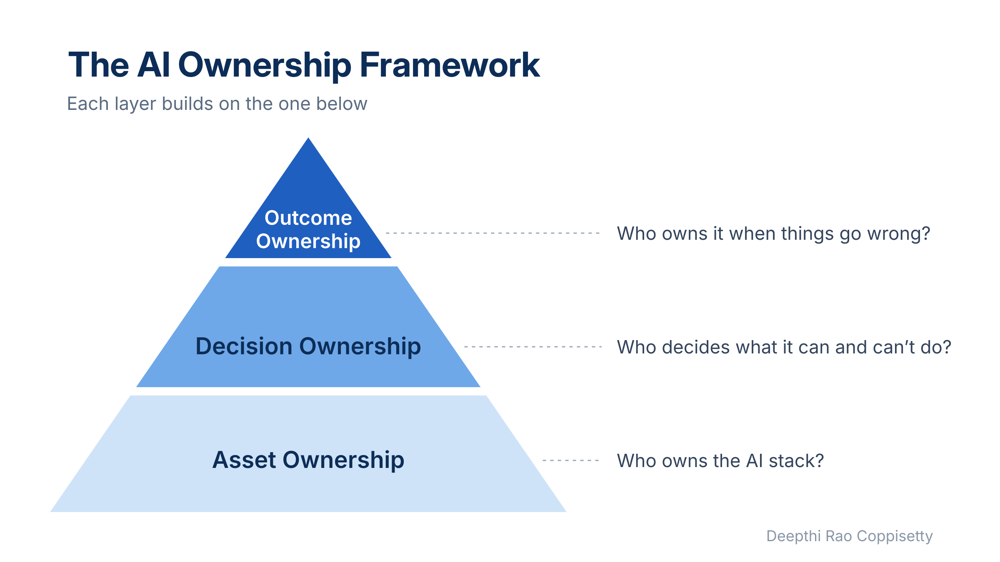
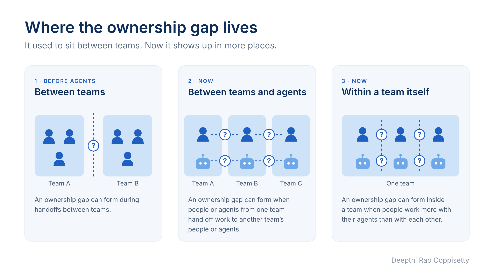

# Your AI Has an Owner. Does Anyone Own What It Does?

Deepthi Rao Coppisetty | November 21, 2026

I've seen this before, long before agents. A change ships, something breaks, and the first hour goes to figuring out who owns it. Now the change can come from an agent, acting on its own.

The first questions are about the fix: What broke? Who owns it? How do we fix it fast and make it stick? The harder question comes after: Who gave the agent approval to do this in the first place?

The model has an owner. The repo has an owner. The service has an owner. Even the agent has an owner. But nobody owned the decision to let the agent act, and nobody owns the outcome now that it has.

That's the governance gap. We govern the AI stack and tools we have, but we don't fully govern the agents running on them: who decides what they can and can't do, or who owns the outcome when things go wrong.

## We Inventoried the Easy Things

Most organizations have done real work on AI governance. They catalog models, classify data, review vendors, and write responsible AI principles.

All of that matters. But it only tells you what you have.

It doesn't answer the questions that matter when something goes wrong. Who decided this system could do this? Who is accountable for what happened?

Once AI starts acting instead of suggesting, those questions get real fast. An assistant that drafts code is a productivity tool. An agent that merges code, changes permissions, or touches customer data is an actor inside your organization. Every agent needs a human who owns its outcome. That isn't necessarily the engineer who owns the agent. It needs to be a leader who can assess and absorb the risk of an undesired outcome of an agent.

The scale is already here, and it's growing faster than ownership.

| Data point                                                                                                                                                      | Source                                                                                                                     |
|-----------------------------------------------------------------------------------------------------------------------------------------------------------------|----------------------------------------------------------------------------------------------------------------------------|
| For **every human**, there are **109** machine identities, including AI agents.                                                                                 | [Palo Alto Networks 2026](https://www2.paloaltonetworks.com/idira/identity-security-landscape-report)                      |
| **About 25,000** AI agents run alongside 40,000 people at McKinsey (Jan 2026), and that number is expected to **equal its human headcount** by the end of 2026. | [IBTimes UK](https://www.ibtimes.co.uk/50-50-future-mckinseys-ceo-reveals-ai-agents-are-set-match-human-staffing-1770406)  |
| The average number of active agents per organization **nearly 3X’ed** in the last 14 months (Feb 2025 to Apr 2026).                                             | [Salesforce Agentic Enterprise Index](https://www.salesforce.com/agentforce/agentic-enterprise-index/)                     |
| The number of agents running at each Fortune 500 company is estimated to grow from **about 15 in 2025 to as many as 150,000 by 2028** (Gartner estimate).       | [Gartner, via Computerworld](https://www.computerworld.com/article/4165686/gartner-sees-untamed-growth-in-agentic-ai.html) |

## The AI Ownership Framework

I think about AI ownership in three layers: Asset Ownership (who owns the AI stack), Decision Ownership (who decides what it can and can't do), and Outcome Ownership (who owns it when things go wrong). Most organizations have the first underway, the second is fuzzy, and the third is where the real work is now.

### 1. Asset Ownership: Who Owns the AI Stack?

This is the most mature layer. It covers the infrastructure, services, repos, data, agents, models, and integrations, which usually have named owners and teams. Each also needs a clear inventory entry, a budget owner, and a lifecycle. That’s the foundation the other two layers build on.

AI costs tend to hide in cloud bills, seat licenses, and usage fees. If nobody owns the spend, nobody notices when an agent loops all weekend and runs up the bill. Showing each team its AI spend, and charging it back, turns ownership into accountability. It's also an early signal that an agent costing more than expected is often doing more than anyone decided it should.

The question to ask: Can you list every component of your AI stack and name the team that owns each one and its budget?

If the answer is no, start here.

### 2. Decision Ownership: Who Decides What It Can and Can't Do?

This is where it gets fuzzy. Someone has to decide what an AI system is allowed to do, under what conditions, with what access, and with what human checkpoints. In practice, that decision is split three ways: governance teams write the policy, security or platform teams enforce it, and the engineer who builds the agent decides what it can actually do.

Today, those decisions are often made implicitly. Someone gives an agent default access because it's faster to set up, and the agent ends up with more access than the job needs. That breaks least privilege, the long-standing security rule that every system gets only the access its work requires. Or a vendor ships an update with AI features turned on by default, and nobody notices. Either way, no one signed off, so no one owns it.

The question to ask: For each AI system that can take action, who approved its access privileges, and where is that decision recorded?

### 3. Outcome Ownership: Who Owns It When Things Go Wrong?

This layer gets the least scrutiny today, and it's where organizations have the most work ahead. When an agent's action causes a security exposure, a bad customer experience, or a compliance issue, a named leader owns the outcome and what happens next. That leader needs real authority to accept the risk, hand it to the right team to fix, or pull the change back fast. Ownership without that authority won't work. And the same leader gets the credit when an agent does something amazing. With clear ownership in place, teams can experiment with confidence and build boldly.

Agent traceability and logging help the leader who owns the outcome see what happened. The logs should show which agent acted, what changed, who approved it, and who owns the agent. With that, the leader can get the facts quickly and reduce time to decision.

Most organizations are learning how to do this. [International Data Corporation (IDC)](https://www.idc.com/?p=122385) finds just 14% of Global 2000 enterprises can continuously verify the decisions their AI agents make, and expects that to reach 70% by 2028.

The questions to ask: If this agent does something harmful tomorrow, who owns the outcome? Do they have the facts to decide what to do next?

## Agent Governance

The ownership gap used to live between teams. Now it lives between teams and between agents. An agent hands a task to another agent, that one calls a third, and the three may belong to three different teams. This gap is starting to show up inside teams too, creating silos as individuals work with agents and collaborate less with their own teammates. Most of our governance controls, like service ownership, decision logs, security reviews, and compliance guidelines, were designed for human-centric systems. They weren't designed for agents that act on their own. We don't need to invent a new governance process. The ones we have can still work. We just need to apply them to agents, and that's what my next article covers.

Our current tools help. They can find agents, trace what they did, and show what they cost. But they only see what we log, and they can't assign an owner. That's the gap, and it's right in the TPM wheelhouse.

## The TPM's Role in Agent Governance

TPMs, and others in similar roles, hold people and process together. They spot gaps, fill them, and often see where things will break before they do. That same skill set applies to hybrid systems of people and agent contributors. In these systems, when gaps show up in ownership, decisions, and risk, they often sit in the space between teams and agents. TPMs can identify those gaps, then work with leaders, directly responsible individuals (DRIs), and governance, risk, and compliance (GRC) and AI governance teams to close them and find the right owners in the engineering org. This doesn't call for a new role. As the industry moves toward agents, it's where the TPM skill set naturally extends.

In practice, that means getting an owner named before an agent goes live. It means working with security and engineering on what gets logged, keeping privileges current when an agent picks up new tools, and making sure every incident has a human owner who manages the risk. None of this is new for TPMs. It just extends to agents now. Agents are making changes faster and at greater scale than TPMs and engineering systems can easily track. A missed owner or a stale permission can turn into an incident much faster. That speed makes ownership work more critical, and it changes how TPMs lead: continuously, and often with agents helping, in addition to existing team check-ins.

## Where to Start

Many organizations already have a governance program that can extend to agents. If yours doesn't, start here. You don't need a giant program to close the gap. Start with three moves:

1.  **Asset Ownership: name an owner for every agent.** List every AI system that can take autonomous action. Give each an owning team and a budget owner.
2.  **Decision Ownership: record who said yes.** For each agent, track who approved its access privileges, and where that decision lives. If no one did, that needs immediate attention.
3.  **Outcome Ownership: name the accountable leader.** Every agent gets one leader who owns its outcomes and has the authority and information to act, and the ability to absorb the risk.

Then establish an automated review process with a regular cadence, because agents, access privileges, and teams change fast.

## The Bottom Line

Asset ownership is a good start. What sets successful governance apart in the agentic world is strong decision and outcome ownership, across every team, including hybrid teams of people and agent contributors.

*I'd like to hear how your teams are handling ownership as agents take on more work. [Connect with me](https://www.linkedin.com/in/cdeepthi/) on LinkedIn to share your thoughts.*

*Note: The views and frameworks shared in this article are solely my own and do not necessarily reflect the official policies or positions of my employer.*
